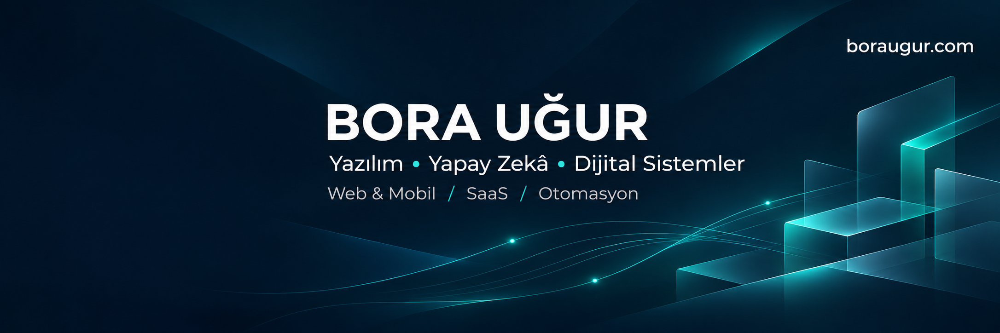

**Freelance Yazılım Geliştirici · İzmir, Türkiye**

İşletmelerin günlük işlerini, kullanımı kolay dijital sistemlere dönüştürüyorum.

[Web sitem](https://boraugur.com) · [LinkedIn](https://www.linkedin.com/in/bora-u%C4%9Fur-1586893a0/) · [Birlikte çalışalım](mailto:mail@boraugur.com)

---

### Merhaba, ben Bora.

Web ve mobil uygulamalar, çok kiracılı SaaS platformları, yönetim panelleri ve iş süreçleri otomasyonları geliştiriyorum. Yapay zekâ destekli geliştirme araçlarını, gerçek işletme ihtiyaçlarını çözmek için kullanıyorum; arayüzden veritabanına, API entegrasyonlarından sunucuya ve yayına alma sürecine kadar çalışıyorum.

🎓 **Atatürk Üniversitesi — Bilgi Yönetimi** öğrencisiyim.  
💼 **Freelance** olarak özel yazılım ve dijitalleşme projeleri üzerinde çalışıyorum.  
🧭 Odağım: **anlaşılır arayüzler, düzenli veri ve sürdürülebilir iş akışları.**

### Neler geliştiriyorum?

<table>
<tr>
<td width="50%" valign="top">
<h3>01 / SaaS & Web</h3>
Web sitesi tasarımı, web ve mobil uygulama geliştirme; çok kiracılı platformlar, yönetim panelleri ve PWA çözümleri.
</td>
<td width="50%" valign="top">
<h3>02 / AI & Otomasyon</h3>
LLM ve API entegrasyonları, veri işleme ve tekrarlayan işleri azaltan otomasyon akışları.
</td>
</tr>
<tr>
<td width="50%" valign="top">
<h3>03 / İşletme Sistemleri</h3>
Lojistik operasyonları, danışan ve klinik takibi, teknik servis, sipariş ve cari hesap yönetimi.
</td>
<td width="50%" valign="top">
<h3>04 / Altyapı & Yayın</h3>
AI destekli sunucu kurulumları, Linux, veritabanları, hosting, DNS, Cloudflare Tunnel ve uygulama dağıtımı.
</td>
</tr>
</table>

### Seçilmiş çalışmalar

Üzerinde çalıştığım ürünler ve işletme çözümleri:

| Çalışma | Çözdüğü ihtiyaç | Odak |
| :--- | :--- | :--- |
| **Atlas OPS** | Nakliye ve lojistikte belge takibi, faturalandırma, sevkiyat ve operasyon kontrolünü bir araya getiren uygulama. | Lojistik · Multi-tenant SaaS |
| **DoboTrack** | Diyetisyenlerin danışan, ölçüm, ödeme ve takip süreçlerini yönetmesini sağlayan platform. | Klinik yönetimi · PWA · AI |
| **EgeBest Service** | Cihaz kabulü, QR kodla takip ve servis işlemlerini dijitalleştiren sistem. | Teknik servis · QR · Yazıcı entegrasyonu |
| **Özel doktor klinikleri** | Hasta takibi ve hekimlere yönelik yapay zekâ destekli tanı desteği uygulamaları. | Klinik yazılımları · AI desteği |
| **Baskı Kapımda** | Baskı ve promosyon ürünlerinde teklif, fiyatlandırma ve sipariş yönetimi. | Ticaret · Operasyon · Yönetim paneli |

> Projelerimin kaynak kodları ve müşteri verileri özeldir. Bu profil yalnızca çalışma alanlarımı ve kamuya açık portföy özetlerimi içerir.

### Öne çıkan deneyim / Atılım Gıda

**Atılım Gıda, bugüne kadarki en önemli çalışmalarım arasında yer alıyor.** Geçmiş görevimde gıda dağıtımı ve soğuk zincir operasyonlarında depo, sevkiyat, veri takibi, raporlama ve saha-merkez entegrasyonunun dijitalleşmesine katkı sağladım. Bu saha deneyimi, gerçek iş ihtiyaçlarını yazılıma dönüştürme yaklaşımımın önemli bir parçası.

### Üretim ve 3D tasarım

**Çözüm Mühendislik — CNC Operatörü (2023)**  
CNC operatörlüğü ve makine kullanımıyla üretim sahasında deneyim kazandım. **Temel CAD/CAM bilgisi**, **3 boyutlu modelleme ve tasarım** da teknik yetkinliklerim arasında yer alıyor.

### Teknoloji çantam

| Katman | Çalıştığım teknolojiler |
| :--- | :--- |
| **Arayüz** | TypeScript · JavaScript · React · Next.js · HTML · CSS · PWA |
| **Backend & Veri** | Node.js · Express · NestJS · PHP / Laravel · Python · SQL · MySQL / MariaDB |
| **AI & Entegrasyon** | OpenAI API · Claude · Ollama · LLM entegrasyonları · REST API |
| **Altyapı & Araçlar** | Linux / Ubuntu · Cloudflare · DNS · Git · GitHub · Docker |

### Çalışma yaklaşımım

**İhtiyacı anla → Sistemi tasarla → Geliştir → Yayına al → Geri bildirimle iyileştir**

Önce işletmenin nasıl çalıştığını anlamaya odaklanırım. Ardından arayüzü, veriyi ve altyapıyı aynı ihtiyacın parçaları olarak ele alır; günlük işlerde kullanılabilecek bir çözüm geliştiririm.

---

### Bir fikri çalışan bir sisteme dönüştürelim.

**Web uygulamaları · SaaS · Otomasyon · AI entegrasyonları**

[**mail@boraugur.com**](mailto:mail@boraugur.com) · [**boraugur.com**](https://boraugur.com)

Building practical digital systems for real business workflows.

